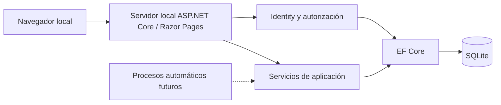

# Arquitectura de Nexo

ASP.NET Core sirve páginas y recursos locales.
La primera iteración establece la capa de acceso; los servicios de reservas y procesos automáticos se incorporarán conforme al backlog.
La persistencia de Identity es técnica y no sustituye al modelo de dominio previsto.
Las futuras operaciones sobre solicitudes obtendrán el empleado de la sesión y comprobarán autorización y reglas en servidor.

## Acceso y almacenamiento

Hay dos cuentas ficticias precargadas: Carlos (Empleado) y Ana (Administrador).
No hay alta de cuentas ni integración con Microsoft 365, Azure o datos de Indra.
Las contraseñas se guardan con el hash de Identity; las credenciales conocidas se documentan únicamente para la demostración local.
Tras un acceso correcto se guarda la fecha de último acceso, que permite comprobar una escritura real y su conservación tras reiniciar.
Esta comprobación técnica no sustituye a las futuras pruebas de persistencia de reservas.

`Datos/nexo.db` contiene la base de datos y `Datos/claves` las claves de protección de cookies.
Un bloqueo exclusivo impide dos procesos sobre la misma carpeta.
La inicialización es transaccional e idempotente.
Las migraciones se versionan y los datos generados no se incorporan a Git.
La aplicación se distribuye con su runtime para Windows x64 y recursos web locales.

## Referencias técnicas

- [ASP.NET Core Identity](https://learn.microsoft.com/aspnet/core/security/authentication/identity?view=aspnetcore-10.0).
- [Ciclo de soporte de .NET](https://dotnet.microsoft.com/platform/support/policy).

Se utiliza .NET 10 LTS y se fijan las versiones NuGet mediante archivos de bloqueo.
El bloqueo de desarrollo y el de publicación Windows se mantienen en archivos separados para que publicar no invalide la restauración habitual.

## Contratos del circuito previsto

Estos contratos describen el diseño aprobado, todavía sin implementación de reservas.
Las operaciones se ejecutarán en servicios de aplicación; las páginas y los procesos periódicos invocarán los mismos servicios.
Las reglas temporales usarán la hora de la sede (Europe/Madrid); los instantes se almacenarán en UTC y la jornada como fecha local.
Se obtendrá el actor desde la sesión o desde la identidad del proceso, sin confiar en un identificador de empleado enviado por el cliente.

| Operación | Entradas | Resultado | Rechazos esperados | Unidad transaccional |
|---|---|---|---|---|
| Reservar | Actor, fecha, zona y puesto solicitado | Identificador de solicitud, estado Pendiente de confirmación y plazos; si procede, En espera sin puesto | Acceso no autorizado, jornada terminada, puesto no habilitado, duplicado activo, conflicto de disponibilidad; una nueva reserva no se adelanta a la espera compatible | Validación definitiva, alta de solicitud y registro de evento en una transacción; las restricciones de unicidad son la última defensa ante concurrencia |
| Confirmar | Actor e identificador de solicitud propia | La misma solicitud pasa a Confirmada; repetir una confirmación válida no duplica eventos | Solicitud ajena, estado incompatible o plazo vencido aunque el proceso periódico aún no haya intervenido | Leer estado/plazo, validar, actualizar y registrar evento de forma atómica |
| Cancelar | Actor e identificador de solicitud | La misma solicitud pasa a Cancelada y conserva su historial; una repetición no duplica registros | Solicitud ajena o transición no permitida | Actualizar estado y guardar evento en una transacción; tras confirmar la liberación se invoca el servicio de asignación |
| Asignar desde espera | Identidad del proceso y fecha/zona a revisar | Actualización de la primera espera compatible a Pendiente de confirmación, con puesto y vencimiento | Ninguna espera o plaza compatible produce un resultado Sin cambios; un conflicto concurrente exige releer y validar antes de reintentar | Selección definitiva, solicitud, asignación, evento y aviso en una transacción; un reintento no duplica efectos |
| Caducar | Identidad del proceso e instante del reloj | Pendientes vencidas y esperas de jornadas terminadas pasan a Caducada | Las confirmadas no cambian; una segunda ejecución no repite efectos | Cada transición guarda estado, evento y aviso de forma atómica; después de confirmar la liberación se comprueba la espera |

La asignación ordenará esperas por entrada e identificador y puestos por código.
Antes de asignar comprobará puesto habilitado, jornada no terminada y ausencia de otra solicitud activa del empleado, excluyendo la propia espera.
La confirmación ordinaria será desde las 08:30 hasta antes de las 09:15; para una asignación posterior a las 09:00 vencerá a los quince minutos, sin superar las 18:00.
Las ventanas se parametrizarán conforme al backlog y se verificarán con un reloj controlado.
Los procesos se ejecutarán al arrancar, antes de admitir nuevas reservas, y cada minuto con la aplicación abierta; la liberación por cancelación solicitará además la comprobación de espera.
Los errores devolverán mensajes comprensibles sin exponer registros ajenos ni dejar escrituras parciales.
El detalle del esquema, índices y normalización queda pendiente del modelo de dominio completo.

## Matriz de permisos

| Recurso | Empleado | Administrador | Situación |
|---|---|---|---|
| Inicio y perfil propio | Consultar su sesión | Consultar su sesión | Implementado |
| Consulta técnica de cuentas precargadas | Denegado, también por URL directa | Solo lectura | Implementado; sin mantenimiento de usuarios |
| Solicitudes | Crear, consultar y cambiar las propias según sus reglas | Actuar dentro de sus permisos sobre el conjunto | Previsto, pendiente de implementar y probar registros ajenos |
| Reservas del equipo | Consulta según pertenencia precargada | Consulta autorizada | Previsto |
| Catálogos, informes e historial global | Denegado | Permitido según alcance aprobado | Previsto |
