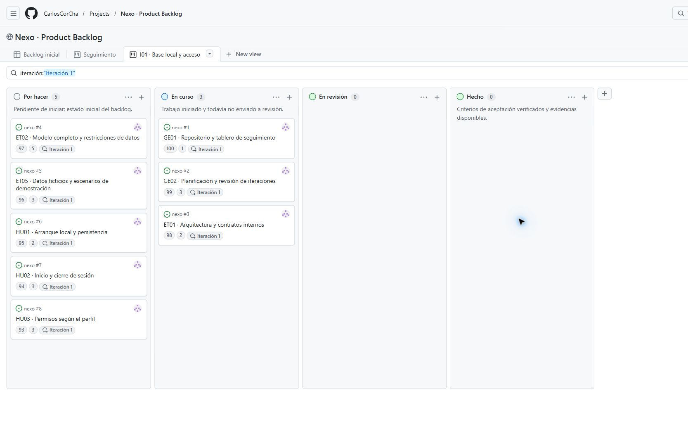
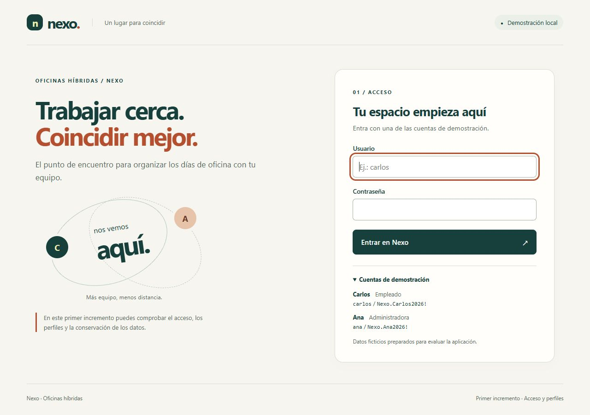
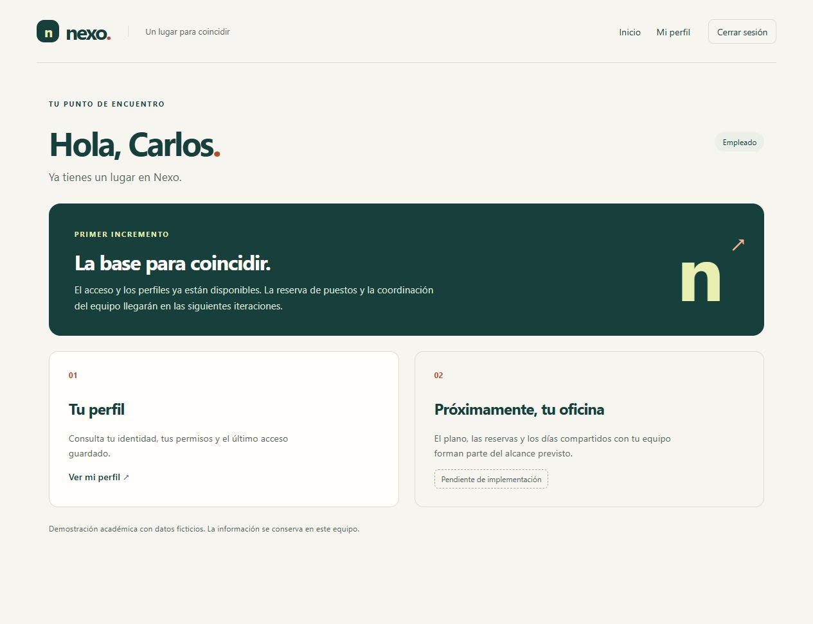
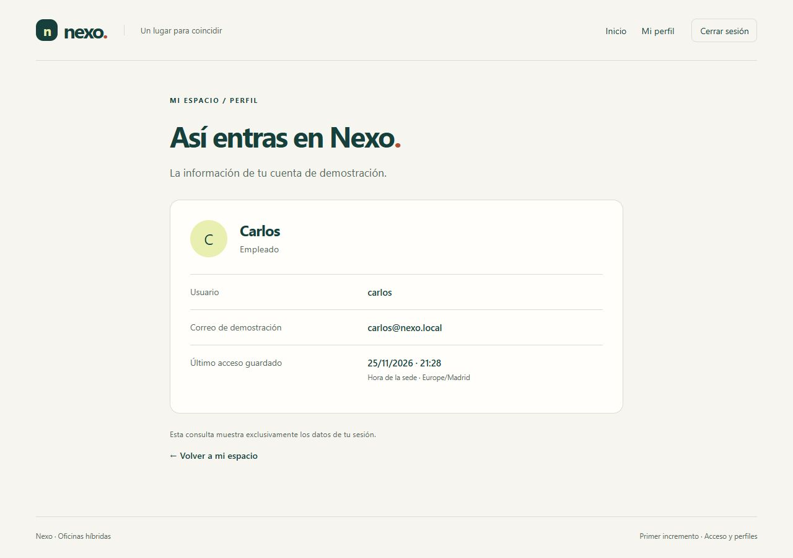
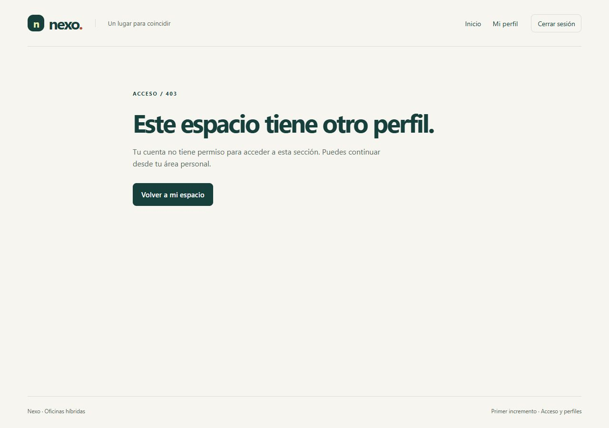
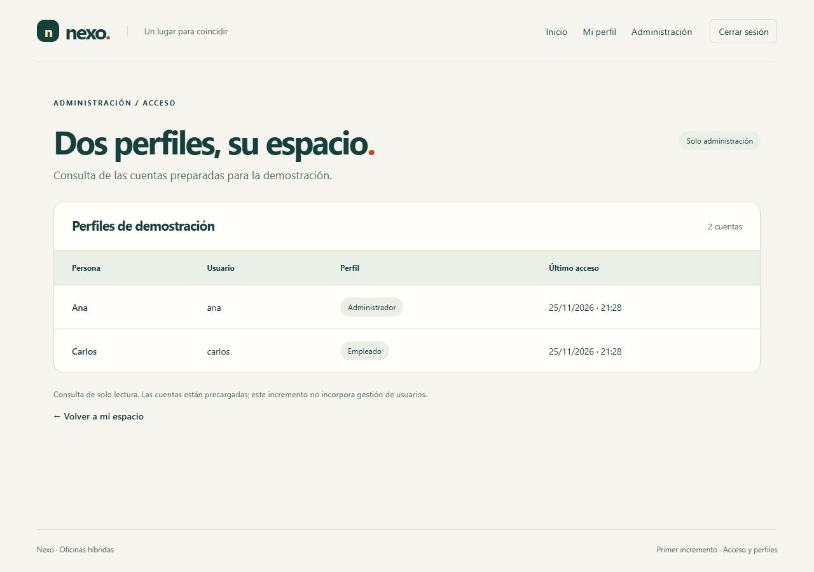
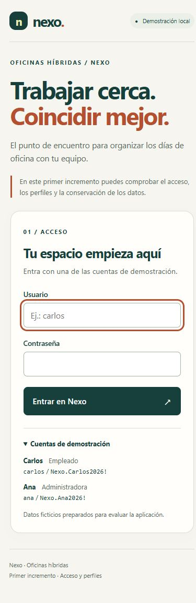
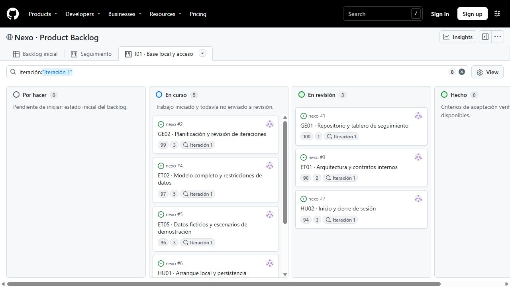

# Manual de implementación · Primer incremento

Nexo · Oficinas híbridas.
Revisión vigente del 28 de noviembre de 2026. Incremento de referencia I01.1.
Los apartados históricos conservan expresamente sus fechas y paquetes originales.
Este manual se ampliará a medida que se implemente el backlog.

## Creación de la aplicación y de SQLite paso a paso

La [guía de creación](creacion-paso-a-paso.md) completa este manual con los comandos, la configuración y cinco capturas anotadas de una reproducción real del 28/11/2026.
Parte de una carpeta nueva, incorpora las fuentes locales de Nexo, genera una migración independiente y verifica la creación de SQLite, las cuentas precargadas, el reinicio, las pruebas y el ZIP.
Las imágenes de comandos muestran los registros originales abiertos en Bloc de notas; la imagen de la aplicación procede del navegador.
Los resultados de esta reproducción son 17 pruebas de integración correctas y 12 comprobaciones correctas del ZIP reconstruido.
El [manifiesto de evidencias](creacion/evidencias.json) relaciona resultados, fechas, registros y capturas.
Para repetirlo se utiliza scripts/reproducir-creacion.ps1 desde la raíz de las fuentes, con otro destino dentro de artifacts para conservar los resultados previos.
La reproducción conserva el alcance de acceso y persistencia técnica; el modelo de oficina y reservas sigue pendiente.

## Versión consolidada del 28 de noviembre

El [manifiesto I01.1](../entregas/I01.1.json) identifica las fuentes y el ZIP de referencia.
Las [pruebas de esta versión](verificacion-I01.1.json) y la [matriz por criterio y tarea](../iteraciones/trazabilidad-01.md) son las evidencias vigentes.
El manual Word y PDF 1.1 añade las decisiones de implementación y conserva cinco capturas de la reproducción didáctica, identificada por separado.

## Resultado disponible

La aplicación arranca desde una carpeta, crea SQLite y permite acceder como Carlos (Empleado) o Ana (Administrador).
Las cuentas y el último acceso se conservan al reiniciar.
La autorización se aplica en servidor y el cierre de sesión exige un POST con token antifalsificación.
Las reservas, el plano y los catálogos todavía no forman parte del incremento ejecutable.

## Evidencias históricas del 25 de noviembre

Las capturas siguientes muestran la versión y el plan de aquella fecha. No sustituyen al manifiesto vigente ni a sus resultados.

## 1. Planificar la iteración

La primera iteración se ajusta al periodo del 25 al 30 de noviembre para respetar el plazo del aula.
El primer plan llegaba al 8 de diciembre; esta captura histórica conserva aquel estado y no sustituye al calendario actualizado.
Se han seleccionado ocho elementos originales y una vista estable filtrada por esa iteración.
El [plan de trabajo](../iteraciones/iteracion-01.md) desglosa veintiuna tareas estimadas en horas bajo sus ocho elementos del backlog.
La estimación revisada es de 16 horas de referencia, sin afirmar dedicación humana real.
Los puntos de historia y las prioridades aprobadas permanecen intactos.
La captura siguiente corresponde al momento de la planificación, antes de terminar el incremento; su estado no pretende sustituir al tablero actual.



## 2. Preparar la solución y los datos

Las fuentes están en `src/Nexo.Web` y las pruebas en `tests/Nexo.Web.Tests`.
La [arquitectura](../arquitectura.md) diferencia lo implementado de los contratos de reservas pendientes.

| Componente | Responsabilidad | Fuente editable |
|---|---|---|
| Arranque | Escuchar en bucle local, configurar servicios y abrir navegador | `src/Nexo.Web/Program.cs` |
| Persistencia | Identity, conexión SQLite y esquema técnico | `src/Nexo.Web/Data/ApplicationDbContext.cs` |
| Inicialización | Crear solo las cuentas y roles ausentes sin borrar datos | `src/Nexo.Web/Data/DemoAccounts.cs` |
| Carpeta de datos | Comprobar escritura y bloquear una segunda instancia | `src/Nexo.Web/Infrastructure/DataDirectory.cs` |
| Acceso | Validar credenciales, guardar último acceso y crear sesión | `src/Nexo.Web/Pages/Acceso/Entrar.cshtml.cs` |
| Autorización | Exigir el perfil administrador en servidor | `src/Nexo.Web/Pages/Administracion/Index.cshtml.cs` |
| Interfaz | Páginas Razor y estilos servidos localmente | `src/Nexo.Web/Pages` y `wwwroot/css/site.css` |

Las migraciones generadas por EF Core se versionan en `Data/Migrations`.
Los archivos SQLite y las claves se generan al ejecutar y quedan fuera de Git.
Para una nueva modificación del esquema se cambia el modelo y se genera una migración con `dotnet ef migrations add`, sin editar una base de datos a mano.

## 3. Arrancar el paquete

Extraer el ZIP completo y ejecutar `INICIAR.cmd` desde una carpeta con escritura.
El paquete incluye el runtime para Windows x64; el evaluador no necesita instalar el SDK ni una base de datos.
El servidor usa `127.0.0.1:5187` y abre la página de acceso.
La consola debe mantenerse abierta y se detiene con Ctrl+C.



| Persona | Usuario | Contraseña ficticia | Perfil |
|---|---|---|---|
| Carlos | `carlos` | `Nexo.Carlos2026!` | Empleado |
| Ana | `ana` | `Nexo.Ana2026!` | Administrador |

Si el puerto está ocupado se presenta un error sin terminar otros programas.
Puede elegirse otro puerto en `appsettings.json` o mediante `NEXO_PORT`.
Si la carpeta no admite escritura se debe extraer en otra ubicación.
La prueba automatizada cubre una ruta de datos inválida; no se han modificado los permisos del sistema para simular una carpeta protegida.

## 4. Comprobar el perfil empleado y la persistencia

Entrar con Carlos y abrir «Mi perfil».
El área muestra su identidad y el instante del último acceso guardado en SQLite.
Detener y arrancar de nuevo conserva el mismo usuario y el dato persistido.
Las pruebas también comprueban que no se duplican usuarios ni roles y que el arranque no restablece contraseñas existentes.





## 5. Probar el permiso en servidor

Con la sesión de Carlos, escribir directamente `/Administracion` en el navegador.
El servidor deriva a una página de acceso denegado con respuesta 403 y no devuelve la consulta restringida.
La ausencia del enlace de administración se complementa con esta comprobación del permiso.
El perfil propio ignora un parámetro que intente seleccionar otra cuenta.
Los permisos sobre solicitudes ajenas se probarán cuando existan las reservas.



## 6. Comprobar el perfil administrador y la salida

Cerrar sesión y comprobar que `/Perfil` vuelve a exigir autenticación.
Entrar con Ana y abrir «Administración».
La consulta muestra las dos cuentas precargadas y sus últimos accesos; no incorpora operaciones de mantenimiento de usuarios.
Las contraseñas y sus hashes no aparecen en esta consulta.



## 7. Revisar adaptación y teclado

Se han revisado las páginas actuales a 1280 píxeles y el acceso y el inicio a 390 píxeles.
Los campos tienen etiquetas, el foco es visible y el formulario permite avanzar con Tab y enviar con Enter.
La revisión móvil no sustituye a los futuros criterios de accesibilidad del plano y las reservas.



## 8. Reproducir las verificaciones

Desde una copia de las fuentes con el SDK .NET 10:

```powershell
./scripts/validar.ps1
./scripts/publicar.ps1
./scripts/probar-paquete.ps1
./scripts/generar-informe.ps1
```

La publicación rechaza sobreescribir una carpeta existente; para otro paquete se usa, por ejemplo, `./scripts/publicar.ps1 -Version iteracion-01-r2`.
La prueba del paquete extrae una copia aislada, conserva los logs y termina únicamente los procesos que ella misma ha creado.

| Verificación ejecutada | Resultado |
|---|---|
| Compilación Release | Sin errores ni advertencias |
| Integración: cuentas, acceso, errores, bloqueo, sesión, hash, antifalsificación, permisos y reinicio | 17 casos correctos; ninguno omitido |
| Ejecutable del ZIP: runtime, carpeta, SQLite, bucle local, acceso, permisos, estilos, bloqueo de instancia, puerto y reinicio | 12 comprobaciones correctas |
| Recorrido de navegador con ambos perfiles | Correcto; capturas guardadas |

El [informe generado](verificacion.json) contiene los nombres, resultados y fechas de las pruebas y el SHA256 del ZIP.
El [manifiesto de capturas](capturas.json) conserva sus fechas reales y hashes.
Los resultados TRX originales y los logs están en `artifacts`, fuera del repositorio.
Las primeras pruebas detectaron un problema en la limpieza de las conexiones SQLite de la batería y una comparación incorrecta de entidades HTML; ambos se corrigieron antes del resultado registrado.

No se ha desconectado la red del equipo: se ha verificado que las referencias y los recursos de las páginas actuales son locales.
La prueba sin Internet del circuito completo, incluido el plano, queda pendiente.

## Seguimiento y acceso del evaluador

Se ha abierto la vista de la iteración y este manual en un navegador sin sesión de GitHub.
Ambos son accesibles para consulta pública.
El tablero conserva ocho elementos seleccionados: tres En revisión y cinco En curso; ninguno figura como Hecho.
El repositorio mantiene las cuarenta incidencias originales y añade una PR de implementación, sin ampliar el backlog.



## Revisión complementaria del 27 de noviembre

Carlos aportó una grabación de su recorrido con ambas cuentas, sin incidencias visibles.
Se completó la revisión autorizada con la URL directa de Administración como Carlos y con un reinicio del ejecutable publicado.
La URL termina en acceso denegado 403; los registros, identificadores, roles, relaciones, migración, claves y último acceso permanecen tras reiniciar.
La sesión sobrevive al reinicio; después de salir, una petición a Perfil exige autenticación.
El DLL, el ejecutable, el CSS y la configuración coinciden con el ZIP validado; no se ha modificado código funcional.

Los [resultados nuevos](verificacion-20261127.json) se distinguen de las diecisiete pruebas de integración y doce comprobaciones del paquete del 25/11.
Las cuatro capturas nuevas y el vídeo base se conservan localmente; su publicación está pendiente de autorización.
No se ha publicado la grabación original de Carlos ni su audio.

## Preparación del primer cierre con corte del 27 de noviembre

Repositorio y seguimiento, arquitectura y contratos, e inicio y cierre de sesión tienen sus criterios cubiertos.
Los otros cinco elementos seleccionados siguen abiertos por sus remanentes o por las formalidades del cierre.
El [informe preparado](../iteraciones/cierre-01.md) tiene fecha de corte 27/11 y mantiene la entrega del 30/11.
La [segunda iteración](../iteraciones/iteracion-02.md) se planifica del 1 al 13 de diciembre, sin declararla iniciada.

- [x] Recorrido de Carlos con ambas cuentas, perfil y salida.
- [x] Verificación del acceso directo rechazado y de la persistencia tras reiniciar.
- [ ] Revisión del PDF combinado y del vídeo base antes de entregar.
- [x] Dedicación personal confirmada por Carlos: 2 horas de planificación y 1 hora de pruebas.
- [ ] Publicación autorizada de las evidencias y comprobación del enlace del vídeo.
- [ ] Completar los apartados finales de la entrega y enviarla al campus.

Solo se registra la dedicación confirmada por Carlos y no se declara una entrega realizada.
Las historias parciales conservan sus criterios pendientes.

## Primera revisión local de interfaz del 28 de noviembre

Se ha preparado una vista previa independiente con una navegación que identifica la página actual, instrucciones de acceso más claras y nuevas tarjetas de perfil y administración.
Se conserva la identidad visual de Nexo y las funciones futuras se distinguen de las disponibles.
La aplicación evita presentar sus fases de desarrollo como instrucciones para la persona que la utiliza.
La explicación técnica permanece en este manual.

La compilación Release terminó sin errores ni advertencias y las diecisiete pruebas de integración existentes fueron correctas.
Se recorrieron el acceso incorrecto, las dos cuentas, el perfil, el rechazo de Administración para Carlos, la consulta permitida para Ana y la salida.
Las mediciones del navegador a 390 píxeles no mostraron desbordamiento horizontal de la página.
La tabla tiene desplazamiento propio y admite teclado; el foco del formulario es visible.

La captura de acceso sí se obtuvo y revisó.
La revisión visual de inicio, perfil, administración y móvil sigue pendiente: el navegador permite navegar y consultar el DOM, pero agota el tiempo al devolver sus capturas.
Una comprobación del DOM no se presenta como revisión visual de esas pantallas.
Los [resultados de esta revisión](interfaz-20261128.json) conservan esa distinción.

El paquete anterior, su vídeo y el informe mantienen la versión que ya fue validada.
Esta vista previa utiliza su propia carpeta de datos y se prepara para recibir feedback antes de incorporarla a esos entregables.
No se han publicado las nuevas capturas ni el vídeo base.

## Resolución de la revisión y versión de referencia

La revisión posterior de I01.1 del 28/11 resuelve el pendiente de capturas de la primera sesión.
Se revisaron visualmente acceso, inicio, perfil, administración y móvil en el navegador, sobre el ejecutable publicado y con datos ficticios separados.
El manifiesto vigente identifica sus capturas por nombre y SHA-256; los medios permanecen locales.
El informe tiene ahora corte del 28/11 e identifica el mismo ZIP I01.1 que las pruebas nuevas.
El vídeo definitivo comentado y la revisión de la declaración de IA se completarán al final, por indicación de Carlos.
Los apartados anteriores se conservan como registros fechados de las revisiones previas.
